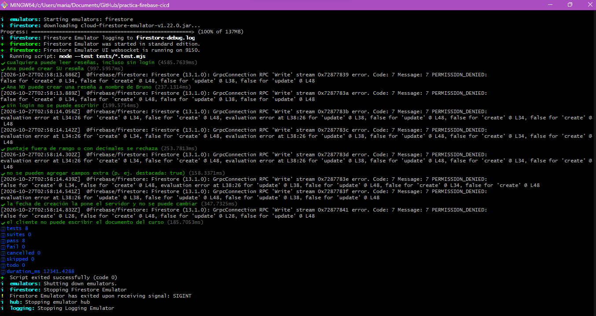
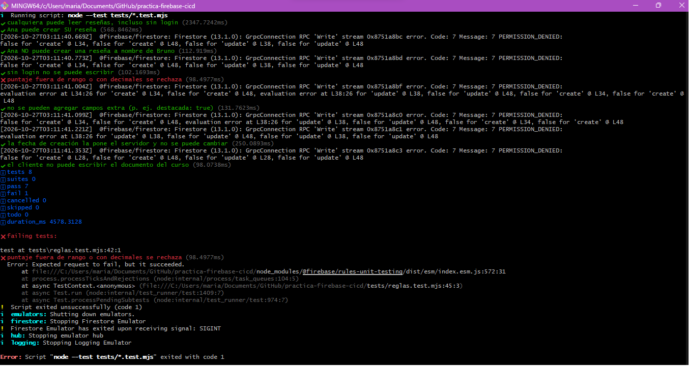
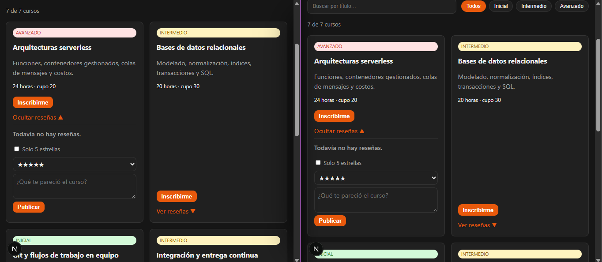
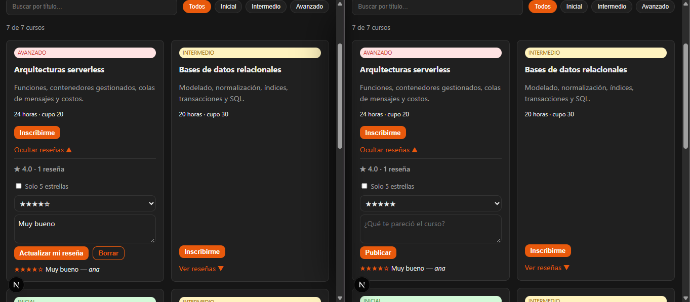

# Reflexión · CI/CD con Firebase Hosting y hardening de headers

**Alumna:** María Melina Duarte · Programación Avanzada 2026 · FCyT Concepción del Uruguay

## Entregables

| # | Entregable | Link |
|---|---|---|
| 1 | Repo | https://github.com/xxMeDuzaa/TP9_pa |
| 2 | Producción | https://practica-ci-cd.web.app |
| 3 | PR mergeado con comentario del bot | https://github.com/xxMeDuzaa/practica-firebase-cicd/pull/2 |

## Mediciones (entregable 4)

### B1 · Antes (producción sin headers)

Calificación securityheaders.com: **D**

Observación: sin configurar nada, Firebase Hosting ya envía `Strict-Transport-Security` por defecto y un `Cache-Control: max-age=3600` igual para todo (HTML y assets). Ese caché de 1 hora en el HTML implica que un deploy o un rollback podía tardar hasta una hora en verse.

```text
▶ HTML: https://practica-ci-cd.web.app/
  status 200
  ✘ content-security-policy (falta)
  ✔ strict-transport-security: max-age=31556926; includeSubDomains; preload
  ✘ x-content-type-options (falta)
  ✘ x-frame-options (falta)
  ✘ referrer-policy (falta)
  ✘ permissions-policy (falta)
  · cache-control: max-age=3600

▶ Asset estático: /_next/static/chunks/1x6obpmlu1_c2.js
  ✘ cache-control: max-age=3600

❌ 6 control(es) pendiente(s).
```

### B5 · Después (producción con headers)

Calificación securityheaders.com: ** A+**

La CSP servida en producción ya no tiene `'unsafe-inline'`: `script-src` lista los `sha256` calculados por `scripts/csp-hashes.mjs` en el pipeline. El HTML pasó de `max-age=3600` a `no-cache` y los assets con hash a un año `immutable`.

```text
▶ HTML: https://practica-ci-cd.web.app/
  status 200
  ✔ content-security-policy: default-src 'self'; script-src 'self' 'sha256-OBTN3RiyCV4Bq7dFqZ5a2pAXjnCcCYeTJMO2I/LYKeo=' 'sha256-bcUxw3Lxd1…
  ✔ strict-transport-security: max-age=31556926; includeSubDomains; preload
  ✔ x-content-type-options: nosniff
  ✔ x-frame-options: DENY
  ✔ referrer-policy: strict-origin-when-cross-origin
  ✔ permissions-policy: camera=(), microphone=(), geolocation=(), payment=(), usb=(), bluetooth=(), serial=(), hid=(), midi=(), magnet…
  · cache-control: no-cache

▶ Asset estático: /_next/static/chunks/1x6obpmlu1_c2.js
  ✔ cache-control: public, max-age=31536000, immutable

✅ Todos los controles pasaron.
```

## Decisiones de configuración

**Pipeline**
- Preview: trigger `pull_request`, `expires: 3d`, `concurrency` por número de PR con `cancel-in-progress: true` (un push nuevo deja obsoleto al build anterior).
- Producción: trigger `push` a `main`, `channelId: live`, `concurrency` grupo `production` con `cancel-in-progress: false` (un deploy cortado a la mitad podría dejar una versión inconsistente; mejor hacer fila), environment `production` para poder exigir aprobación manual.
- Trazabilidad: en el PR uso `github.event.pull_request.head.sha` y `github.head_ref`, porque `github.sha` en un `pull_request` es el *merge commit* sintético que GitHub arma para probar, no el último commit de la rama. En `main` uso `github.sha` y `github.ref_name`.
- Gate: después de desplegar el preview, el workflow corre `check-headers.mjs` contra la URL del preview; si falta un header, el check del PR queda en rojo.

**Caché**
- Regla general `**` → `Cache-Control: no-cache` (el navegador puede guardar el HTML pero tiene que revalidar con ETag en cada visita).
- Regla específica `/_next/static/**` → `public, max-age=31536000, immutable`. Va después de la general porque, si dos reglas definen el mismo header, gana la última.

**CSP final**

```text
default-src 'self'; script-src 'self' 'unsafe-inline'; style-src 'self';
img-src 'self' https://picsum.photos https://fastly.picsum.photos; font-src 'self';
connect-src 'self'; object-src 'none'; base-uri 'self'; form-action 'self';
frame-ancestors 'none'; upgrade-insecure-requests
```

Esa es la versión commiteada. Nota: en esta máquina el emulador local no aplicó los headers de `firebase.json`, así que la validación la hice en un preview channel real (`npm run deploy:preview`), que pasó todos los controles. En el pipeline, `scripts/csp-hashes.mjs` corre después del build y reemplaza `'unsafe-inline'` por los `sha256` de los scripts inline de ese build, así que **lo que llega a preview y a producción no tiene `'unsafe-inline'`**.

## Preguntas

### 1. ¿Por qué el preview tiene vencimiento?
Un preview es una URL pública con código que todavía no se revisó. Si nunca vence se acumulan versiones viejas accesibles por cualquiera que tenga el link (que queda en el PR, en chats, en el historial): pueden tener bugs o vulnerabilidades ya corregidas en producción, datos de prueba o features no anunciadas, y un buscador podría indexarlas. Además, Firebase limita la cantidad de canales por sitio, así que sin vencimiento se llenan. Con `expires: 3d` el entorno es efímero: existe mientras se revisa y después desaparece solo.

### 2. Desplegar vs. liberar
**Desplegar** es poner una versión en la infraestructura; **liberar** es hacer que los usuarios reales la reciban. En este flujo, el workflow de PR *despliega* a un preview channel pero no libera nada: producción no cambia. Se *libera* cuando la versión pasa al canal `live`, ya sea por el merge a `main`, por `hosting:clone` de un preview a `live` (libera algo que ya estaba desplegado, sin recompilar) o por un rollback, que vuelve a liberar una versión anterior que seguía guardada en Hosting. Como cada release de Firebase es una versión inmutable, liberar o volver atrás es solo mover un puntero, por eso tarda segundos.

### 3. Clave de la service account
Un repo (y más uno público) es copiado, clonado y queda en el historial de git para siempre: una clave commiteada se considera filtrada aunque después se borre. En un secreto de GitHub se guarda cifrada, solo se expone a los workflows, se enmascara en los logs y no se entrega a PRs que vienen de forks. Quien obtenga la clave puede desplegar cualquier contenido en `<project>.web.app` (defacement, phishing o malware bajo un dominio confiable), borrar canales o hacer rollbacks, y usar cualquier otro permiso que tenga esa cuenta en el proyecto. Para limitar el daño: darle solo el rol **Firebase Hosting Admin** (mínimo privilegio, que es lo que crea `firebase init hosting:github`), proteger `main` y el environment `production` con revisión obligatoria, rotar la clave periódicamente y ante cualquier sospecha, revisar los audit logs de GCP, y, mejor todavía, reemplazar la clave JSON por **Workload Identity Federation** (OIDC de GitHub Actions), que da credenciales de corta duración y no deja ninguna clave que filtrar.

### 4. ¿Por qué la CSP rompió la app?
Con `script-src 'self'` la página cargaba pero el filtro de `/cursos` no respondía. En `out/cursos.html` se ve que Next.js incrusta scripts inline (`<script>self.__next_f.push([1,"…"])</script>`) con el payload RSC que React necesita para **hidratar** los componentes de cliente, y además un `<script id="_R_">` de Turbopack que arranca la carga de los chunks (en total, 5 scripts inline distintos en este build). La CSP bloquea todo script inline que no esté autorizado, así que el HTML se ve pero React nunca toma el control de los eventos. La imagen de portada también desaparecía por `img-src 'self'`: `picsum.photos` responde con un redirect a `fastly.picsum.photos`, y la CSP se evalúa en cada salto del redirect, así que hay que permitir los dos orígenes exactos (no `https:` ni `*`).

Opciones evaluadas:

| Opción | Costo de seguridad |
|---|---|
| `'unsafe-inline'` en `script-src` | Alto: si alguien logra inyectar HTML (XSS) puede ejecutar cualquier script inline; la CSP deja de proteger contra el ataque principal para el que existe. |
| Nonce por request | Ideal, pero necesita un servidor que genere un nonce distinto en cada respuesta. Con hosting estático no hay. |
| **Hashes `sha256`** (elegida para lo desplegado) | Bajo: solo se ejecutan los scripts inline exactos que generó el build; uno inyectado tiene otro hash y se bloquea. El costo es operativo: los hashes cambian en cada build (el SHA del footer viaja en el payload), así que hay que calcularlos en el pipeline, entre `next build` y el deploy. Por eso está el paso `csp-hashes.mjs`. |
| `'strict-dynamic'` + hash | Útil si los scripts cargan otros dinámicamente; acá los chunks ya son `'self'`, no hace falta. |

### 5. ¿Qué ataque mitiga cada header de B2?
- **Strict-Transport-Security** (`max-age=63072000; includeSubDomains`, 2 años): impide *SSL stripping* y downgrade a HTTP en redes hostiles (un Wi-Fi público que intercepta la primera petición). El navegador recuerda que el sitio solo va por HTTPS. Detalle: `.app` ya está en la lista de precarga HSTS de los navegadores, así que `web.app` está protegido incluso en la primera visita; el header igual hace falta para dominios propios. No agregué `preload` porque no controlo el dominio. En la medición se ve que en `*.web.app` Firebase sobrescribe el valor configurado con el suyo (`max-age=31556926; includeSubDomains; preload`); el de `firebase.json` aplicaría en un dominio propio.
- **X-Content-Type-Options: nosniff**: evita el *MIME sniffing*, por ejemplo que un archivo subido como `.txt` o imagen con contenido JS/HTML sea interpretado y ejecutado como script (XSS por confusión de tipos).
- **X-Frame-Options: DENY**: evita el *clickjacking*: otro sitio no puede meter el nuestro en un iframe invisible para que el usuario haga clic sin saberlo. Se complementa con `frame-ancestors 'none'` en la CSP, que es la versión moderna.
- **Referrer-Policy: strict-origin-when-cross-origin**: evita filtrar la URL completa (rutas, parámetros con tokens o datos de búsqueda) a sitios de terceros. Hacia afuera solo se manda el origen, y nada si se baja de HTTPS a HTTP.
- **Permissions-Policy**: desactiva cámara, micrófono, geolocalización, pago, USB, sensores, etc. Si se inyecta un script o un iframe de terceros, no puede pedir esos permisos (reduce la superficie para espionaje o fingerprinting). El catálogo no usa ninguna, así que se niegan todas.
- Extras: **Cross-Origin-Opener-Policy: same-origin** aísla la ventana de popups de otros orígenes (mitiga ataques tipo XS-Leaks/Spectre y *tabnabbing*); **X-Permitted-Cross-Domain-Policies: none** bloquea políticas de clientes Flash/PDF heredados.

### 6. ¿Por qué `/_next/static/` se cachea un año y el HTML no?
Los archivos de `/_next/static/` tienen un hash del contenido en el nombre (`page-3f9a1c.js`): si el código cambia, cambia el nombre, así que un archivo con un nombre dado **nunca** va a tener otro contenido y se puede marcar `immutable`. El HTML, en cambio, siempre se sirve en la misma URL (`/cursos`) y es el que apunta a los assets de la versión actual. Si el HTML quedara cacheado un año, un deploy nuevo o, peor, un **rollback** no le llegaría al usuario: seguiría viendo la versión vieja (o la que se quiso retirar) hasta que expire su caché. Con `no-cache` el navegador revalida en cada visita (si no cambió responde 304, barato) y ve el cambio en cuanto se libera. Este esquema hace que deploys y rollbacks sean instantáneos para el usuario sin sacrificar rendimiento: lo pesado (JS y CSS) se baja una sola vez por versión.

### 7. Si la app necesitara SSR
- **Arquitectura**: no alcanza con archivos estáticos. Habría que usar **Firebase App Hosting** (o Cloud Run), donde Next corre como un servidor Node en contenedores; el pipeline construye una imagen y el rollback pasa a ser entre revisiones del servicio. Aparecen cold starts, logs del servidor, variables de entorno y secretos en runtime.
- **CSP**: mejora. El servidor puede generar un **nonce** distinto por request (por ejemplo en el middleware/proxy de Next) y usar `script-src 'nonce-…' 'strict-dynamic'`, sin `'unsafe-inline'` ni hashes recalculados en CI. Los headers se podrían definir en código además de en la config. Como contrapartida, ese HTML ya no se puede cachear en el CDN porque el nonce cambia en cada respuesta.
- **Costo**: App Hosting exige el plan **Blaze** (con tarjeta, pago por uso de Cloud Run, Cloud Build y Artifact Registry). Deja de ser costo cero garantizado y hay que poner alertas de presupuesto.

### A6 · Ciclo completo y rollback (registro)

| Paso | Canal | Versión en el footer | Release de Hosting |
|---|---|---|---|
| PR #2 abierto (`feat/titulo`) | preview `pr2-feat-titulo` | `aac91c9` · rama `feat/titulo` · título nuevo | — |
| Mientras tanto, producción sin cambios | live | `d5c3527` · `main` · título viejo | `bd4a4d` |
| Merge del PR #2 | live | `30c9d46` · `main` · título nuevo | `b39f71` |
| Rollback desde la consola (versión `bd4a4d`) | live | `d5c3527` · `main` · título viejo | `bd4a4d` |
| Bonus: `hosting:clone practica-ci-cd:pr2-feat-titulo practica-ci-cd:live` | live | `aac91c9` · `feat/titulo` · título nuevo | copia del preview |

El preview muestra `aac91c9` (último commit de la rama) y producción `30c9d46` (el merge commit que GitHub crea en `main`), por eso los SHA difieren entre canales. En el bonus, producción pasó a mostrar exactamente `aac91c9` / `feat/titulo`: `hosting:clone` copia los archivos ya compilados del preview, sin build nuevo, así que se libera bit a bit lo que se revisó. El rollback tardó segundos porque Hosting solo vuelve a apuntar `live` a una versión ya subida, sin recompilar. Elegí `bd4a4d` y no `c446a2` porque esta última es el deploy manual de la medición B1, sin headers: hacer rollback a ella habría reabierto el problema de seguridad.

**Incidente en el pipeline:** el primer run del PR #2 falló en el gate con `status 404`: el script consultó el canal recién creado en el mismo segundo del deploy, antes de que el CDN lo sirviera. Lo corregí haciendo que el paso espere hasta recibir HTTP 200 (con reintentos cada 5 s, hasta unos 2 minutos) antes de verificar los headers. Un gate de verificación tiene que tolerar la consistencia eventual del CDN, porque si no da falsos negativos.

### Rollback: ¿qué pasa con `main`?
Después del rollback en la consola, `live` sirve la versión anterior pero `main` sigue con el código nuevo: el repo y producción quedan desincronizados. En el próximo merge el pipeline compila `main` completo y **vuelve a publicar el cambio que se había retirado**, junto con lo nuevo. En un equipo real, el rollback en consola se usa como mitigación inmediata y enseguida se corrige el repo: un `git revert` del commit problemático por PR (así `main` refleja lo que está en producción y queda registro), o un *roll forward* con el arreglo. Otra opción es usar feature flags para desactivar el cambio sin redeploy.

### Bonus · promoción sin recompilar
`npx firebase hosting:clone practica-ci-cd:CANAL practica-ci-cd:live` copia los archivos exactos que se revisaron en el preview al canal `live`. Lo que se aprobó es bit a bit lo que se libera (no hay un segundo build que pueda dar otro resultado). La contra es que el footer va a mostrar la rama del PR y su SHA, no `main`.

---

# Clase 2 · SQL Connect: modelo relacional y autorización

## Entregables

| # | Entregable | Estado |
|---|---|---|
| 1 | `dataconnect/` completo (L1–L4 + L5) | https://github.com/xxMeDuzaa/TP9_pa/tree/main/dataconnect |
| 2 | Salida de `npm run atacar` antes y después | Abajo |
| 3 | PR mergeado con el cambio de CSP (L6) | https://github.com/xxMeDuzaa/TP9_pa/pull/1 · preview: https://practica-ci-cd--pr1-feat-sql-connect-yhslkigz.web.app/ |
| 4 | Producción con inscripción (L7) | https://practica-ci-cd.web.app/ |
| 5 | Reflexión | Abajo |

## Auditoría · `npm run atacar`

Se omiten las líneas de log `@firebase/data-connect: ... Error while performing request` que imprime el SDK cada vez que el servidor rechaza una llamada (son los ataques bloqueados, no errores del script).

### Antes de corregir (L1–L3 hechas, `ListAlumnos` todavía `PUBLIC`)

```
Auditoría de SQL Connect · proyecto practica-ci-cd · emuladores locales

✔ ListCursos responde sin login (7 cursos) — público por diseño
✘ ListAlumnos devuelve datos personales SIN login
    Ejemplo filtrado: {"email":"melina@test.com","id":"S0uFhQP6a2fEVRvJOplZmRG8ZJCc","nombre":"Melina"}
✔ Inscribirme rechazada sin login
    unauthenticated: this operation requires a signed-in user
✔ Inscribirme es idempotente (repetir no falla)
✔ MisInscripciones solo devuelve lo del usuario que llama
… DarmeDeBaja todavía no existe (TODO L5, opcional)

❌ 1 vulnerabilidad(es) · 1 pendiente(s)
```

### Después (L4 `NO_ACCESS` + L5)

```
Auditoría de SQL Connect · proyecto practica-ci-cd · emuladores locales

✔ ListCursos responde sin login (7 cursos) — público por diseño
✔ ListAlumnos rechazada para un cliente
    unauthorized: you are not authorized to perform this operation
✔ Inscribirme rechazada sin login
    unauthenticated: this operation requires a signed-in user
✔ Inscribirme es idempotente (repetir no falla)
✔ MisInscripciones solo devuelve lo del usuario que llama
✔ B no puede dar de baja a A

✅ Todos los controles pasaron
```

Los dos rechazos son distintos: `Inscribirme` sin token da `UNAUTHENTICATED` (falta identidad: con login funcionaría), mientras que `ListAlumnos` da `PERMISSION_DENIED` (`@auth(level: NO_ACCESS) always reject non-admin requests`): aunque el usuario esté logueado, ningún cliente puede ejecutarla.

## Decisiones

- **L1 · Clave compuesta `(alumno, curso)`** en lugar de un UUID propio: la unicidad de la inscripción la garantiza PostgreSQL (`PRIMARY KEY (alumno_id, curso_id)`), no la app. Las claves foráneas tienen `ON DELETE CASCADE`: si se borra un alumno o un curso, se borran sus matrículas. `fecha` usa `@default(expr: "request.time")`, así que el cliente no puede inventarla.
- **L2 · `upsert` y no `insert`**: con `matricula_insert`, inscribirse dos veces falla por clave duplicada (la base no duplica, pero la operación da error). `matricula_upsert` actualiza la fila existente, así que repetir la llamada deja el mismo estado y no falla: es idempotente. Sirve para reintentos de red o doble clic.
- **L5 · `matricula_delete(key: { alumnoId_expr: "auth.uid", cursoId })`**: la clave a borrar incluye el UID del token, así que un usuario solo puede borrar su propia fila aunque conozca el `cursoId` de otro.
- **Mejora posible · cupo**: hoy nada impide inscribir más alumnos que `Curso.cupo`. No se puede expresar con una restricción simple de la tabla (depende de contar filas de otra), así que habría que validarlo en la mutation (por ejemplo, con `@check` sobre una query previa dentro de una `@transaction`) o con un trigger en PostgreSQL. Además convendría `CHECK (cupo > 0)` y `CHECK (horas > 0)` en `Curso`.
- **Frontend · caché del SDK**: `executeQuery` usa `PREFER_CACHE` por defecto, y después de inscribirse o darse de baja la lista quedaba vieja hasta refrescar. `misInscripciones()` ahora usa `fetchPolicy: SERVER_ONLY`, y el catálogo marca los cursos en los que el usuario ya está inscripto.

## Producción (L7) · deploy y migración

`npx firebase deploy --only dataconnect` activó las APIs `firebasedataconnect` y `sqladmin`, creó el servicio `catalogo` (us-east4), publicó el conector `cursos` y empezó a crear la instancia Cloud SQL `catalogo-fdc` bajo la prueba sin costo. Como la instancia todavía se estaba creando, el CLI salteó la migración del SQL (`Skip SQL schema migration because Cloud SQL is still being created`): mientras tanto SQL Connect guarda los datos en una base temporal y los migra al terminar.

Con la instancia lista, `npx firebase dataconnect:sql:diff` compara el esquema de los `.gql` con la base real:

```
+  dataconnect: Database schema of catalogo-fdc:fdcdb matches SQL Connect Schema exactly.
```

**Análisis:** no queda ninguna migración pendiente: las tablas de PostgreSQL coinciden exactamente con `schema.gql`. La migración que se aplicó es la misma que mostró el emulador al agregar `Matricula` en la L1:

```sql
CREATE TABLE "public"."matricula" (
  "alumno_id" text NOT NULL, "curso_id" uuid NOT NULL, "fecha" timestamptz NOT NULL,
  PRIMARY KEY ("alumno_id", "curso_id"),
  CONSTRAINT "matricula_alumno_id_fkey" FOREIGN KEY ("alumno_id") REFERENCES "public"."alumno" ("id") ON DELETE CASCADE,
  CONSTRAINT "matricula_curso_id_fkey" FOREIGN KEY ("curso_id") REFERENCES "public"."curso" ("id") ON DELETE CASCADE
);
CREATE INDEX "matricula_alumnoId_idx" ON "public"."matricula" ("alumno_id");
CREATE INDEX "matricula_cursoId_idx" ON "public"."matricula" ("curso_id");
```

- La clave compuesta de la L1 se traduce en un `PRIMARY KEY` de dos columnas: la unicidad la aplica PostgreSQL.
- `alumno: Alumno!` y `curso: Curso!` generan las claves foráneas, con `ON DELETE CASCADE`.
- SQL Connect crea además un índice por cada clave foránea. El de `alumno_id` es el que usa `MisInscripciones` (buscar las matrículas de un alumno), y el de `curso_id` serviría para contar inscriptos por curso (por ejemplo, para validar el cupo).
- `fecha` es `NOT NULL` sin `DEFAULT` en SQL: el `request.time` lo completa SQL Connect al ejecutar la mutation, no PostgreSQL.
- Antes de cambiar el esquema en producción, `sql:diff` permite ver qué SQL se va a ejecutar. Un cambio que borre o modifique columnas podría perder datos, así que conviene revisarlo antes del deploy.

## Preguntas

### 1. ¿Por qué ninguna operación recibe el id del alumno? IDOR y `auth.uid`
Porque el cliente no es de confianza: cualquiera puede leer la config pública y llamar a la API con las variables que quiera. Si `MisInscripciones` recibiera `$alumnoId`, un usuario logueado podría pasar el id de otro y leer sus inscripciones; `@auth(level: USER)` no lo frena, porque solo verifica que haya *alguien* logueado, no que sea el dueño. Eso es **IDOR** (*Insecure Direct Object Reference*, API1 del OWASP API Top 10): el servidor confía en una referencia a un objeto que manda el cliente sin verificar que le pertenezca. Con `auth.uid` el id sale del token que firma Firebase Auth y verifica el servidor; el cliente no puede cambiarlo.

### 2. `ListCursos` PUBLIC y `ListAlumnos` NO_ACCESS: criterio y panel de admin
El criterio es qué dato expone y quién lo necesita (mínimo privilegio). El catálogo es información pública que la app muestra sin login. `ListAlumnos` devuelve nombre y email de todos los alumnos: son datos personales y la app no la usa. `USER` no alcanzaba, porque cualquier alumno logueado podría listar los emails de los demás.
El panel de admin no debería usar el SDK del cliente. Opciones: usar herramientas con privilegios de administrador, que no pasan por `@auth` (Admin SDK desde un backend o Cloud Function, `firebase dataconnect:execute`, la consola); o, si el panel es parte de la app, darle a los administradores un *custom claim* (`admin: true`, asignado con el Admin SDK) y proteger la operación con `@auth(expr: "auth.token.admin == true")`, así solo esos tokens pueden ejecutarla.

### 3. Clave compuesta vs validar duplicados en el cliente
La validación en el cliente se saltea llamando a la API directamente (justo lo que hace `atacar`) y además tiene condiciones de carrera: dos pedidos simultáneos pueden pasar el "¿ya está inscripto?" antes de que alguno inserte. La clave primaria compuesta la aplica PostgreSQL de forma atómica en cada escritura, venga de donde venga. La regla vive en un solo lugar, el más cercano a los datos.

### 4. La config de Firebase es pública: ¿por qué no compromete la base? ¿Qué faltaría?
La `apiKey` identifica el proyecto, no autoriza nada. Lo que protege los datos es que el cliente solo puede ejecutar las operaciones con nombre definidas en el conector, cada una con su `@auth`, y que la identidad sale del token de Firebase Auth. Lo que no frena es a alguien que use esa config desde un script propio para llamar a las operaciones permitidas (crear cuentas en masa, inscribirse en todo, abusar de `ListCursos`). Para eso está **App Check**: el servidor exige además un token que certifica que la llamada viene de la app real (en web, con reCAPTCHA Enterprise), y rechaza scripts y clientes no registrados.

### 5. SQL Connect vs una API REST propia (Express + pg)
**SQL Connect:** no tengo que escribir ni mantener un servidor: declaro las operaciones en los `.gql` y Firebase las ejecuta. El cliente solo manda el nombre de la operación y sus variables, así que la inyección SQL queda cerrada por diseño. La autorización (`@auth`) y la identidad (`auth.uid`) se declaran al lado de cada operación, y se audita toda la API leyendo dos archivos. El esquema genera las tablas y migraciones solo. A cambio, la lógica de negocio queda limitada, dependo de Google Cloud y, al terminar la prueba de 90 días, se paga.

**Express + pg:** escribo yo el servidor, cada endpoint y cada consulta SQL. Tengo control total: puedo agregar cualquier regla de negocio (cupo, mails, pagos), elegir y optimizar cada consulta, y llevarlo a cualquier hosting sin depender de un proveedor. Pero toda la seguridad depende de mí: verificar el token en cada ruta, validar las entradas y parametrizar el SQL para evitar inyección. Un olvido en una sola ruta la deja expuesta. Además tengo que desplegar, actualizar y escalar el servidor, y manejar las migraciones.

### 6. ¿Por qué no alcanzó la CSP de la clase 1 y por qué dominios exactos en `connect-src`?
La CSP de la clase 1 tenía `connect-src 'self'`: el navegador solo permitía `fetch`/XHR al mismo origen (`practica-ci-cd.web.app`). En la clase 1 alcanzaba porque los cursos estaban en el código, pero ahora la app le habla directamente desde el navegador a Firebase Auth y a SQL Connect, que están en otros dominios, y el navegador bloqueaba esas llamadas (`Refused to connect`). Agregué solo los tres orígenes que usa la app:

- `https://identitytoolkit.googleapis.com`: Firebase Auth (registrarse e iniciar sesión).
- `https://securetoken.googleapis.com`: Firebase Auth (renovar el token cuando vence).
- `https://firebasedataconnect.googleapis.com`: SQL Connect (ejecutar las queries y mutations).

No usé `https://*.googleapis.com` porque ese comodín abre cientos de APIs de Google (Drive, Storage, Gmail...). Si un atacante lograra inyectar un script en la página, podría mandar los datos robados a un recurso suyo en alguna de esas APIs y la CSP no lo frenaría. `connect-src` es la última barrera contra la exfiltración de datos: cuanto más exacta la lista, menos salidas tiene un script malicioso. Además, una lista exacta documenta con qué servicios habla la app.


---

## Práctica 4 · Firestore

### Entregables

| # | Entregable | Estado |
|---|---|---|
| 1 | `lib/resenas.ts`, `ResenasCurso.tsx`, `firestore.rules`, `firestore.indexes.json` y `tests/` | https://github.com/xxMeDuzaa/TP9_pa/tree/main |
| 2 | Salida de `npm run test:reglas` y prueba de "hacerlo fallar" | Abajo |
| 3 | Tiempo real entre dos navegadores | Abajo |
| 4 | PR mergeado con reglas, índice y CSP | https://github.com/xxMeDuzaa/TP9_pa/pull/4 · preview: https://practica-ci-cd--pr4-feat-firestore-xhy13ia5.web.app/ · producción: https://practica-ci-cd.web.app/ |
| 5 | Reflexión | Abajo |

### Tests de reglas · `npm run test:reglas`

**Los 8 tests en verde** contra el emulador de Firestore:



Las líneas `PERMISSION_DENIED` que aparecen en el medio no son errores: son las escrituras que las reglas rechazan (reseña a nombre de otro, puntaje 6, campo extra...), y el test pasa justamente porque esperaba ese rechazo.

**Hacerlo fallar a propósito:** cambié en `firestore.rules` `d.puntaje <= 5` por `d.puntaje <= 6`. El test *"puntaje fuera de rango o con decimales se rechaza"* se puso en rojo (`pass 7`, `fail 1`, *Expected request to fail, but it succeeded*), lo que demuestra que ese test realmente prueba el límite del puntaje. Después volví a `<= 5` y los 8 quedaron en verde otra vez.



**Nota sobre el script:** el enunciado propone `node --test tests/`, pero Node no acepta una carpeta como argumento de `--test` (falla con `Cannot find module '.../tests'`). Lo cambié por un patrón: `node --test tests/*.test.mjs`.

### Tiempo real entre dos navegadores

Dos sesiones distintas (ventana normal e incógnito, con otra cuenta) mirando las reseñas del mismo curso. Antes de publicar:



Se publica desde la izquierda y la reseña aparece en la derecha sin recargar (`onSnapshot`):



**Detalle encontrado al probar:** al borrar una reseña, el promedio quedaba con el valor viejo. La lista se actualiza al instante por la compensación de latencia, pero la consulta de agregación se pedía al servidor antes de que confirmara el borrado. Ahora el resumen se recalcula solo cuando el snapshot no tiene escrituras pendientes (`snap.metadata.hasPendingWrites === false`).

### Preguntas

#### 1. ¿Por qué el id del documento es el UID? ¿Qué agregarías si usaras ids aleatorios con `addDoc`?
El id del documento es el UID porque así cada usuario tiene una sola ruta posible por curso (`cursos/{cursoId}/resenas/{uid}`): si escribe de nuevo, se actualiza la misma reseña en lugar de crear otra, y la regla de seguridad solo tiene que comparar el id con `request.auth.uid`. Si usara `addDoc`, el id ya no diría quién es el autor, así que tendría que guardar un campo `autorUid` y validar en las reglas que coincida con `request.auth.uid` al crear, editar y borrar. En conclusión, usar el UID como id hace que la regla de "una reseña por persona" la cumpla la estructura de los datos, sin código extra.

#### 2. ¿Qué ganás y qué perdés al copiar el nombre del autor? ¿Cómo resolverías el cambio de nombre?
Al copiar el nombre en la reseña gano que, para mostrar la lista, no tengo que hacer una lectura extra por cada reseña para buscar el nombre, ya que Firestore no tiene JOIN. Lo que pierdo es que el dato queda duplicado: si alguien cambia su nombre, sus reseñas viejas siguen mostrando el anterior. Para resolverlo, cuando el usuario cambia su nombre habría que actualizar el campo `autor` en todas sus reseñas, idealmente desde el servidor para no depender del cliente. En conclusión, la desnormalización conviene cuando un dato se lee mucho y cambia poco, como el nombre de una persona.

#### 3. ¿Qué diferencia hay entre `resource.data` y `request.resource.data`?
`resource.data` es el documento como está guardado antes de la operación, mientras que `request.resource.data` es cómo quedaría después si se permite la escritura. Nuestra regla de `update` usa los dos para que la fecha no se pueda cambiar: exige `request.resource.data.creadaEn == resource.data.creadaEn`, es decir, que la fecha del documento resultante sea la misma que la que ya estaba guardada. En conclusión, comparar el antes con el después permite validar cambios y no solo el estado final.

#### 4. ¿Por qué la creación exige `creadaEn == request.time`?
La creación exige esa condición porque la fecha del cliente no es confiable: la computadora puede tener mal la hora o alguien puede mandar una fecha inventada a propósito. `request.time` es la hora del servidor, y `serverTimestamp()` hace que sea el servidor quien complete la fecha; si el cliente manda otra, la escritura se rechaza, como comprueba uno de los tests. En conclusión, los datos que tienen que ser confiables los pone el servidor, no el cliente.

#### 5. ¿Qué limitación tiene `getAggregateFromServer` y qué alternativas hay?
`getAggregateFromServer` no funciona en tiempo real ni offline: devuelve el resultado del momento en que se pide, por eso la lista de reseñas se actualiza sola pero el promedio no, y hay que volver a pedirlo. Lo vimos al probar: después de borrar una reseña, la lista quedó vacía pero el promedio siguió mostrando 4.0 hasta que corregimos cuándo se recalcula. Una alternativa es guardar el promedio y la cantidad en el documento del curso y escucharlo con `onSnapshot`, actualizándolo desde el servidor. En conclusión, la agregación sirve para un resumen puntual, pero si se necesita en tiempo real hay que guardarlo como dato.

#### 6. Inscripciones con cupo máximo: ¿Firestore o SQL Connect?
Para inscripciones con cupo usaría SQL Connect, porque el cupo depende de contar cuántas inscripciones tiene un curso, y una base relacional puede hacerlo dentro de una transacción. Además, en la clase 2 la clave compuesta alumno + curso de `Matricula` ya impide inscribirse dos veces. En Firestore, las reglas validan un documento por vez y no pueden contar, así que tendría que mantener un contador aparte y sería más fácil equivocarse. En conclusión, Firestore conviene para datos en tiempo real como las reseñas, y SQL Connect para datos con reglas de integridad como las inscripciones con cupo.
